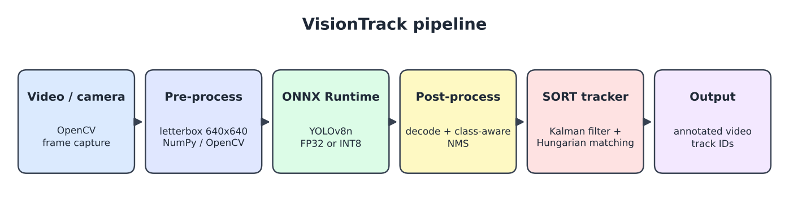
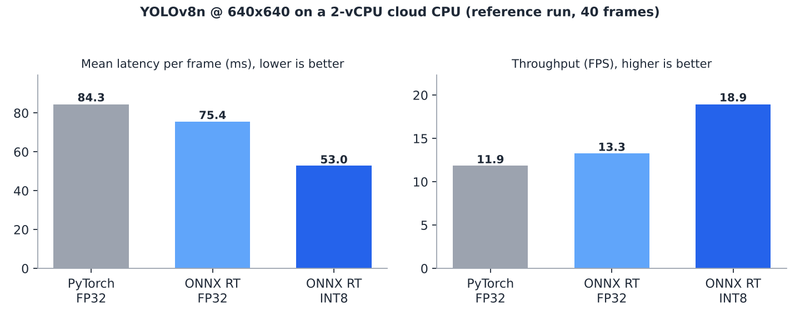

# VisionTrack: Real-Time Object Detection & Multi-Object Tracking on ONNX Runtime

An end-to-end computer vision pipeline: **YOLOv8 detection -> ONNX export -> INT8 post-training quantization -> ONNX Runtime inference -> Kalman-filter multi-object tracking**, with a benchmark that measures accuracy-vs-latency trade-offs for edge deployment.



## What's inside

| Component | File | Details |
|---|---|---|
| Model export | `export_onnx.py` | PyTorch (YOLOv8n) -> ONNX (opset 13) -> static INT8 QDQ quantization with calibration frames |
| Inference engine | `visiontrack/detector.py` | ONNX Runtime session; letterbox pre-processing, YOLOv8 output decoding and class-aware NMS in NumPy/OpenCV |
| Tracker | `visiontrack/tracker.py` | SORT-style tracker from scratch: constant-velocity Kalman filter (7-D state), IoU cost matrix, Hungarian assignment (SciPy) |
| Pipeline | `run_track.py` | Video/webcam -> detection -> tracking -> annotated video, with per-stage latency |
| Benchmark | `benchmark.py` | PyTorch vs ONNX FP32 vs ONNX INT8: mean/p50/p95 latency, FPS, detection agreement with the PyTorch baseline |
| Tests | `tests/test_tracker.py` | IoU, ID persistence under motion, recovery from missed detections |

## Engineering notes

- **Quantization debugging:** naive INT8 quantization of the whole graph produced zero detections. YOLOv8's output tensor concatenates box coordinates (0-640) and class scores (0-1), so quantizing the decode head destroys the scores. The detection-head decode stage (DFL, box decoding, sigmoid, final concat) is kept in FP32 while the backbone and neck convolutions run INT8.
- **Tracker math:** state `[cx, cy, area, aspect, vx, vy, v_area]`; predict step `x = Fx`, `P = FPF^T + Q`; update uses the innovation `y = z - Hx`, covariance `S = HPH^T + R`, and gain `K = PH^T S^-1`.
- **Calibration:** use 100+ frames from your target scenes (`data/calib/`) for representative activation ranges.

## Quick start

```bash
pip install -r requirements.txt
# put ~100 representative frames (jpg/png) in data/calib/
python export_onnx.py --weights models/yolov8n.pt          # yolov8n.onnx + yolov8n_int8.onnx
python run_track.py --model models/yolov8n_int8.onnx --source video.mp4 --output out.mp4
python benchmark.py --images data/calib
pytest -q
```

## Results

Reference run from `benchmark.py`: 2-vCPU cloud CPU, 640x640 input, 40 frames, YOLOv8n, INT8 calibrated on only 12 sample frames. Numbers will differ on other hardware, so re-run `benchmark.py` on yours.



| Model | Size | Mean latency | p95 | FPS | Agreement vs PyTorch (IoU>0.5) |
|---|---|---|---|---|---|
| PyTorch FP32 | 6.2 MB | 84.3 ms | 99.8 ms | 11.9 | baseline |
| ONNX Runtime FP32 | 12.8 MB | 75.4 ms | 96.6 ms | 13.3 | 93.9% |
| ONNX Runtime INT8 | 3.7 MB | 53.0 ms | 67.2 ms | 18.9 | 91.4% |

The agreement metric compares detections against the PyTorch model on a small sample set. It is a sanity check, not a substitute for mAP on a labeled dataset such as COCO val.

## Possible extensions

- Evaluate mAP on a COCO subset and MOTA/IDF1 on a MOT17 sequence
- Add Re-ID appearance features (DeepSORT-style) to reduce ID switches
- TensorRT / CUDA execution provider for GPU deployment
- C++ inference wrapper around the ONNX model

## Licensing note

Model weights and export tooling come from [Ultralytics YOLOv8](https://github.com/ultralytics/ultralytics), which is licensed under AGPL-3.0. Check its license terms before any commercial use.
